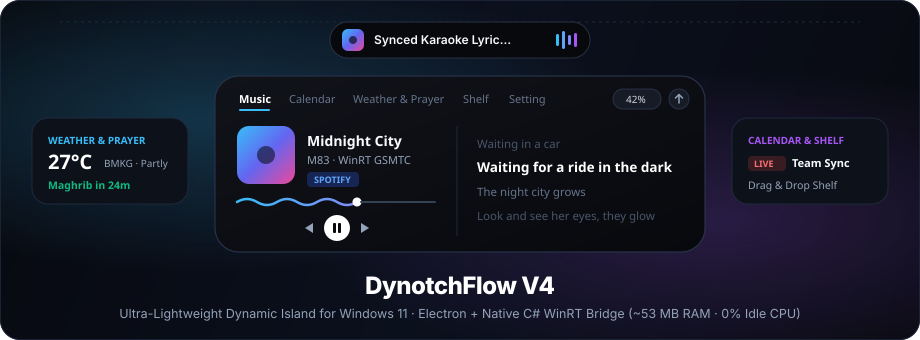
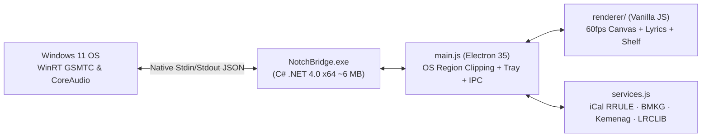

<div align="center">



<br />

# DynotchFlow

**An ultra-lightweight, macOS-style Dynamic Island for Windows 10 & 11**  
*WinRT Media & Live Synced Lyrics · Multi-Calendar (`.ics`) · BMKG Weather & Prayer Times · Drag-and-Drop Notch Shelf*

[](https://github.com/Asikraam/DynotchFlow/releases)
[](https://github.com/Asikraam/DynotchFlow/actions)
[](LICENSE)
[](https://github.com/Asikraam/DynotchFlow/releases)
[](#architecture--performance)

**English** · [Bahasa Indonesia](docs/README_ID.md)

[Download Installer (`.exe`)](https://github.com/Asikraam/DynotchFlow/releases/latest) · [Features](#features) · [Google Calendar Setup](#google-calendar-setup-10-seconds) · [Build from Source](#build-from-source)

</div>

---

## Why DynotchFlow?

Most desktop Dynamic Island overlays run heavy polling scripts or leave ugly translucent DWM titlebars around the pill on Windows 11. **DynotchFlow V4** combines Electron's smooth UI canvas with a compiled **64-bit native C# WinRT bridge (`NotchBridge.exe`)** and dynamic OS window-region clipping (`win.setShape`):

- **Zero DWM Caption Artifacts:** Real-time `SetWindowRgn` scanline clipping shapes the OS window to the exact concave ears and rounded bottom of the island — `0px` stray pixels outside the pill.
- **0ms Optimistic Media Control:** Native Windows GSMTC playback (`Play/Pause/Next/Prev/Seek`) with instant UI updates and a **60fps wavy canvas scrubber** that suspends automatically when paused.
- **~53 MB RAM & 0% CPU Idle:** Zero-IPC state diffing, cached album art & lyric DOM nodes, `--in-process-gpu`, and smart memory working-set trimming only when collapsed.
- **100% Portable & Self-Installing:** Single `.exe` installer sets up `%LOCALAPPDATA%\Programs\DynotchFlow` with Desktop & Start Menu shortcuts in ~2 seconds.

---

## Features

| Module | Highlights |
| :--- | :--- |
| **Music & Synced Lyrics** | Works with Spotify, Chrome, Edge, Brave, YouTube Music, and any Windows GSMTC source. Features adaptive album-art accent colors, blur backdrop, and word/line-highlighted synced lyrics via **LRCLIB** (shown both expanded and in the collapsed pill). |
| **Multi-Calendar (`.ics`)** | Paste one or multiple Google Calendar iCal (`.ics`) URLs (comma/newline separated) + add quick local agendas (`+ Agenda`). Supports `RRULE` (`DAILY`/`WEEKLY` + `INTERVAL`), `EXDATE` exclusions, `LIVE` & countdown badges, and pre-meeting notifications. |
| **Weather & Prayer Times** | Atmospheric Apple-Weather-inspired sky effects (`Rain` / `Sun` / `Night`), 4-slot forecast transitions via **BMKG Indonesia** (with global **Open-Meteo** fallback), and daily **Kemenag RI / myQuran** 5-prayer schedule with configurable H-10m, H-5m & Adzan reminders. |
| **Notch Shelf & Volume** | Drag-and-drop files, images, or clipboard notes into the island and drag files back out natively to Explorer, browsers, or chat apps. Scroll directly over the pill volume badge to step Windows Master Volume cleanly in even increments (`±2`). |
| **Smart Auto-Hide** | Top-bezel cursor watcher (`Alt+H` / `Ctrl+Alt+H`) hides the pill cleanly above the screen edge for unobstructed full-screen screenshots; auto-hides only when a fullscreen app runs on the **same monitor** (Per-Monitor DPI V2 aware). |

---

## Installation (1-Click Setup)

1. Download **`DynotchFlow_V4_Public_Setup.exe`** from [**GitHub Releases**](https://github.com/Asikraam/DynotchFlow/releases/latest).
2. Double-click the `.exe` to install to `%LOCALAPPDATA%\Programs\DynotchFlow`, create Desktop & Start Menu shortcuts, and launch immediately.

> **Note on Windows Defender SmartScreen:** Because DynotchFlow is an independent open-source project without a paid commercial Authenticode certificate, Windows may show *"Windows protected your PC"* on first launch. Click **More info** → **Run anyway** *(or build directly from the auditable source below)*.

### Personalize Your City
Open the **Setting** tab → enter your city under **Kota BMKG & Sholat Kemenag** (default: `Jakarta`) → click **Terapkan**. It automatically geocodes any city worldwide for Open-Meteo and resolves BMKG / Kemenag codes across Indonesia.

### Google Calendar Setup (10 Seconds)
DynotchFlow keeps all calendar data strictly local to your PC:
1. Open the **Kalender** tab and click **Sambungkan Google Calendar (.ics)** *(or go to **Setting → Ambil Link**)*.
2. In the Google Calendar Settings page that opens, pick a calendar → scroll to **Secret address in iCal format** → click **Copy**.
3. DynotchFlow's clipboard listener detects the `.ics` URL automatically and syncs your schedule.  
   *(Tip: To combine multiple calendars, paste several `.ics` links separated by a comma or space into **Setting → Google Calendar (.ics)** and click **Simpan**.)*

---

## Keyboard Shortcuts & API

| Shortcut / Endpoint | Action |
| :--- | :--- |
| `Alt + H` / `Ctrl + Alt + H` | Toggle **Auto-Hide to Top Edge** (slide up above bezel; touch top edge to reveal) |
| `Ctrl + Alt + N` | Toggle total visibility (show / hide island) |
| `Scroll` on volume pill | Adjust Windows Master Volume in even `±2` steps |
| `POST http://127.0.0.1:17420/push` | Trigger custom toast notification from local scripts (`{"title":"...","body":"...","accent":"#38bdf8","duration":4500}`) |
| `GET http://127.0.0.1:17420/health` | Local health check (`{"ok":true,"app":"NotchFlow","version":"4.0.0"}`) |

---

## Architecture & Performance



- **Zero Background Polling Bloat:** `NotchBridge.exe` halts IPC payloads whenever playback is paused and skips memory working-set trims while expanded so animations stay 60fps.
- **No Unbounded Disk Caches:** Lyrics and HD album art caches auto-prune (`max 160` entries) under `%APPDATA%\NotchFlow`.

---

## Build from Source

Prerequisites: **Windows 10/11 (64-bit)** and **Node.js 18+** (built-in `.NET Framework 4.x csc.exe` is already included in Windows).

```powershell
git clone https://github.com/Asikraam/DynotchFlow.git
cd DynotchFlow
npm install

# Compile the native WinRT C# Media & CoreAudio Bridge
$fw  = "$env:WINDIR\Microsoft.NET\Framework64\v4.0.30319"
$wrt = Get-ChildItem $fw -Recurse -Filter "System.Runtime.WindowsRuntime.dll" | Select-Object -First 1 -ExpandProperty FullName
& "$fw\csc.exe" /nologo /optimize+ /target:exe /out:NotchBridge.exe `
  /r:"$fw\System.Runtime.dll" /r:"$fw\System.Threading.Tasks.dll" /r:"$fw\System.IO.dll" `
  /r:"$fw\System.Runtime.InteropServices.WindowsRuntime.dll" /r:"$wrt" `
  /r:"$env:WINDIR\System32\WinMetadata\Windows.Media.winmd" `
  /r:"$env:WINDIR\System32\WinMetadata\Windows.Foundation.winmd" `
  /r:"$env:WINDIR\System32\WinMetadata\Windows.Storage.winmd" `
  NotchBridge.cs

npm start
```

---

## Credits & License

- UI aesthetics inspired by Apple Dynamic Island, [Alcove](https://tryalcove.com/), and [NotchNook](https://lo.cafe/notchnook).
- Powered by **Electron**, **Windows Runtime (GSMTC / CoreAudio)**, **BMKG Indonesia**, **Open-Meteo**, **myQuran API (Kemenag RI)**, **LRCLIB**, and **iTunes Search API**.
- Licensed under the [**MIT License**](LICENSE).
