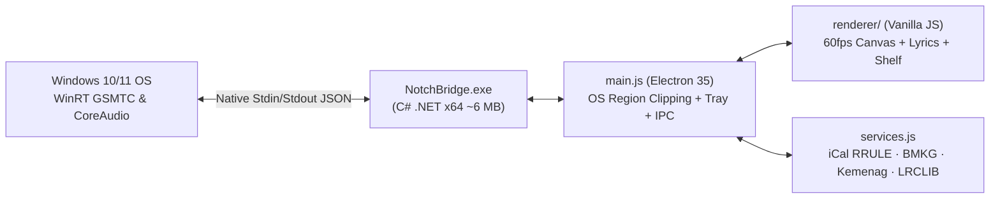

<div align="center">


<br />

# DynotchFlow

**An ultra-lightweight, macOS-style Dynamic Island for Windows 10 & 11**  
*WinRT Media & Live Synced Lyrics · YouTube / DJ / Slowed+Reverb Sync · Multi-Calendar (`.ics`) · BMKG Weather & Prayer Times · Drag-and-Drop Notch Shelf*

[](https://github.com/Asikraam/DynotchFlow/releases)
[](https://github.com/Asikraam/DynotchFlow/actions)
[](LICENSE)
[](https://github.com/Asikraam/DynotchFlow/releases)
[](#architecture--performance)

**English** · [Bahasa Indonesia](docs/README_ID.md)

[Downloads & Platforms](#downloads--platforms) · [Features](#features) · [Google Calendar Setup](#google-calendar-setup-10-seconds) · [Build from Source](#build-from-source)

</div>

---

## Why DynotchFlow?

Most desktop Dynamic Island overlays run heavy background polling scripts or leave jagged translucent DWM titlebars around the pill on Windows 11. **DynotchFlow** combines a streamlined Electron UI with a compiled **64-bit native C# WinRT bridge (`NotchBridge.exe`)** and clean OS window-region clipping:

- **Zero DWM Titlebar Artifacts & Crisp Corners:** Native `MakeFramelessClean` + padded `SetWindowRgn` scanline clipping renders smooth anti-aliased concave ears and bottom corners with `0px` stray border halo.
- **0ms Optimistic Media Control + Universal Live / DJ / Unofficial Lyrics (`< 50 MB` RAM):** Native Windows GSMTC (`Play/Pause/Next/Prev/Seek`) with a **60fps wavy canvas scrubber**, universal fuzzy title matching across **LRCLIB**, **iTunes canonical spelling**, **Kugou LRC**, and **`lyrics.ovh`** (official tracks, live concerts, fancams, acoustic covers, and DJ/Slowed+Reverb remixes), plus **1-Tap Instant Sync** (right-click any lyric line), **2-Point Live Band Tempo Auto-Warp**, `-5s / -0.5s / +0.5s / +5s` quick calibration, and per-video saved offsets (`lyrics-sync.json`).
- **< 50 MB RAM & 0% CPU Idle:** Hard V8 heap cap (`--max-old-space-size=48`), `--in-process-gpu`, cached lyric DOM nodes, and smart idle trimming without slowing expanded animations.
- **Hybrid Auto-Center + Marquee Pill Lyrics:** Short lines sit sharp and centered inside `30px` / `34px` / `40px` pill heights (with proportional font scaling), smoothly switching to edge-faded marquee scrolling only when a line overflows.

---

## Downloads & Platforms

Choose the build that matches your operating system from [**GitHub Releases**](https://github.com/Asikraam/DynotchFlow/releases/latest):

| Platform / OS | Package / Build | Status | Notes |
| :--- | :--- | :--- | :--- |
| **Windows 10 / 11 (x64)** | `DynotchFlow-Setup-v1.0.0-win-x64.exe` | **Available (`v1.0.0`)** | 1-click installer (`%LOCALAPPDATA%\Programs\DynotchFlow`, Desktop & Start Menu shortcuts) |
| **Windows 10 / 11 (x64)** | `DynotchFlow-v1.0.0-win-x64-Portable.zip` | **Available (`v1.0.0`)** | Extract anywhere and run `DynotchFlow.exe` directly with zero installation |
| **macOS (Apple Silicon / Intel)** | Native Cocoa / MediaRemote Bridge | **Planned / Source UI** | Electron renderer runs from source; macOS CoreAudio/MediaRemote bridge PRs welcome |
| **Linux (X11 / Wayland)** | MPRIS2 D-Bus Media Bridge | **Experimental / Source** | Electron UI runs from source; native MPRIS2 & shape bridge support planned |

### Windows 1-Click Setup
1. Download **`DynotchFlow-Setup-v1.0.0-win-x64.exe`** *(or **`DynotchFlow-v1.0.0-win-x64-Portable.zip`**)* from [**GitHub Releases**](https://github.com/Asikraam/DynotchFlow/releases/latest).
2. Verify the installer's **SHA-256 checksum** shown in the Release notes if desired (`Get-FileHash DynotchFlow-Setup-v1.0.0-win-x64.exe`).
3. Double-click the `.exe` to install and launch immediately.

<details>
<summary>SHA-256 Checksums (<code>v1.0.0</code> Windows x64)</summary>

| Artifact | SHA-256 |
| :--- | :--- |
| `DynotchFlow-Setup-v1.0.0-win-x64.exe` | `693D23C4EDBB774AE9F837095C7703A8D4207EF62D5ADB2F40C444B5D0656B13` |
| `DynotchFlow-v1.0.0-win-x64-Portable.zip` | `386244BEF5EBCB9DB576F5AE17595A0BDF158A4CB3D485DBBBA9D40DBAC05E17` |

</details>

> **Note on Windows Defender SmartScreen:** Because DynotchFlow is an independent open-source project without a paid commercial Authenticode certificate, Windows may show *"Windows protected your PC"* on first launch. Click **More info** → **Run anyway**, inspect our [GitHub Actions CI builds](https://github.com/Asikraam/DynotchFlow/actions), or compile directly from source below.

---

## Features

| Module | Highlights |
| :--- | :--- |
| **Music & Synced Lyrics** | Supports Spotify, YouTube Music, Chrome, Edge, Brave, VLC, and any Windows GSMTC player. Matches official, live concert, fancam, acoustic cover, and DJ/Slowed+Reverb uploads via LRCLIB, iTunes canonical lookup, and Kugou LRC. Features **Right-Click / 1-Tap `"Pas-in"` snap**, **2-Point Live Tempo Auto-Warp**, `-5s / -0.5s / +0.5s / +5s` nudges, and per-video calibration memory. |
| **Multi-Calendar (`.ics`)** | Paste one or multiple Google Calendar secret iCal (`.ics`) links (comma/newline separated) + add quick local agendas (`+ Agenda`). Supports `RRULE` (`DAILY`/`WEEKLY` + `INTERVAL`), `EXDATE` exclusions, `LIVE` & countdown chips, and start alerts. |
| **Weather & Prayer Times** | Atmospheric sky effects (`Rain` / `Sun` / `Night`), 4-slot forecast transitions via **BMKG Indonesia** (with global **Open-Meteo** fallback), and daily **Kemenag RI / myQuran** 5-prayer schedule with H-10m, H-5m & Adzan reminders. |
| **Notch Shelf & Volume** | Drag-and-drop files, images, or notes into the island and drag files back out natively to Explorer or web apps. Scroll over the collapsed pill volume icon to step Windows Master Volume cleanly in even increments (`±2`). |
| **Customizable Size & Auto-Hide** | Switch between **`30px` / `34px` / `40px`** pill sizes with proportional typography, slide horizontally along your display (`Kiri / Tengah / Kanan` or pixel slider), toggle Top-Edge Auto-Hide (`Alt+H`), or hide automatically when fullscreen runs on the same monitor. |

### UI Gallery

<table>
  <tr>
    <td width="50%" align="center">
      
      <br /><sub><b>Music &amp; Live Synced Lyrics</b> · Wavy Scrubber, Album Glow &amp; Tempo Sync (`0.86x`)</sub>
    </td>
    <td width="50%" align="center">
      
      <br /><sub><b>Multi-Calendar (<code>.ics</code>)</b> · Category Filters, LIVE &amp; Countdown Pills</sub>
    </td>
  </tr>
  <tr>
    <td width="50%" align="center">
      
      <br /><sub><b>Weather &amp; Prayer Times</b> · Atmospheric Sky FX, BMKG &amp; Kemenag RI</sub>
    </td>
    <td width="50%" align="center">
      
      <br /><sub><b>Notch Shelf</b> · Native Drag-In / Drag-Out File &amp; Note Staging</sub>
    </td>
  </tr>
</table>

---

## Quick Configuration

### Personalize Your City
Open the **Setting** tab → enter your city under **Kota BMKG & Sholat Kemenag** (default: `Jakarta`) → click **Terapkan**. It automatically resolves BMKG/Kemenag city codes across Indonesia and falls back to global Open-Meteo geocoding worldwide.

### Google Calendar Setup (10 Seconds)
All calendar data stays strictly local on your machine:
1. Open the **Kalender** tab and click **Sambungkan Google Calendar (.ics)** *(or go to **Setting → Ambil Link**)*.
2. In Google Calendar Settings, choose a calendar → scroll to **Secret address in iCal format** → click **Copy**.
3. DynotchFlow detects the copied `.ics` URL automatically and syncs your schedule. *(Paste multiple `.ics` URLs separated by commas or spaces to merge work, study, and personal calendars.)*

---

## Keyboard Shortcuts & Local API

| Shortcut / Endpoint | Action |
| :--- | :--- |
| `Alt + H` / `Ctrl + Alt + H` | Toggle **Auto-Hide to Top Edge** (slide above bezel; hover top edge to reveal) |
| `Ctrl + Alt + N` | Toggle total visibility (show / hide island) |
| `Scroll` on volume pill | Adjust Windows Master Volume in clean even `±2` steps |
| `POST http://127.0.0.1:17420/push` | Push custom JSON toast notification (`{"title":"...","body":"...","accent":"#38bdf8","duration":4500}`) |
| `GET http://127.0.0.1:17420/health` | Local health endpoint (`{"ok":true,"app":"DynotchFlow","version":"1.0.0"}`) |

---

## Architecture & Performance



- **Zero Background Polling Bloat:** `NotchBridge.exe` halts high-frequency position pushes while paused, and `main.js` caps V8 memory (`--max-old-space-size=48`) with `--in-process-gpu` so idle footprint stays **under 50 MB RAM**.
- **Bounded Disk Caches:** Synced lyrics and HD album art caches auto-prune (`max 160` entries) under `%APPDATA%\NotchFlow`.

---

## Build from Source

Prerequisites: **Windows 10/11 (64-bit)** and **Node.js 18+** (built-in `.NET Framework 4.x csc.exe` is already included in Windows).

```powershell
git clone https://github.com/Asikraam/DynotchFlow.git
cd DynotchFlow
npm install

# Compile the native WinRT C# Media & CoreAudio Bridge
$fw  = "$env:WINDIR\Microsoft.NET\Framework64\v4.0.30319"
$wrt = Get-ChildItem $fw -Recurse -Filter "System.Runtime.WindowsRuntime.dll" | Select-Object -First 1 -ExpandProperty FullName
& "$fw\csc.exe" /nologo /optimize+ /target:exe /out:NotchBridge.exe `
  /r:"$fw\System.Runtime.dll" /r:"$fw\System.Threading.Tasks.dll" /r:"$fw\System.IO.dll" `
  /r:"$fw\System.Runtime.InteropServices.WindowsRuntime.dll" /r:"$wrt" `
  /r:"$env:WINDIR\System32\WinMetadata\Windows.Media.winmd" `
  /r:"$env:WINDIR\System32\WinMetadata\Windows.Foundation.winmd" `
  /r:"$env:WINDIR\System32\WinMetadata\Windows.Storage.winmd" `
  NotchBridge.cs

npm start
```

---

## Credits & License

- UI aesthetics inspired by Apple Dynamic Island, [Alcove](https://tryalcove.com/), and [NotchNook](https://lo.cafe/notchnook).
- Powered by **Electron**, **Windows Runtime (GSMTC / CoreAudio)**, **BMKG Indonesia**, **Open-Meteo**, **myQuran API (Kemenag RI)**, **LRCLIB**, **lyrics.ovh**, and **iTunes Search API**.
- Licensed under the [**MIT License**](LICENSE).
