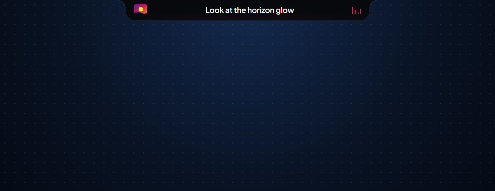
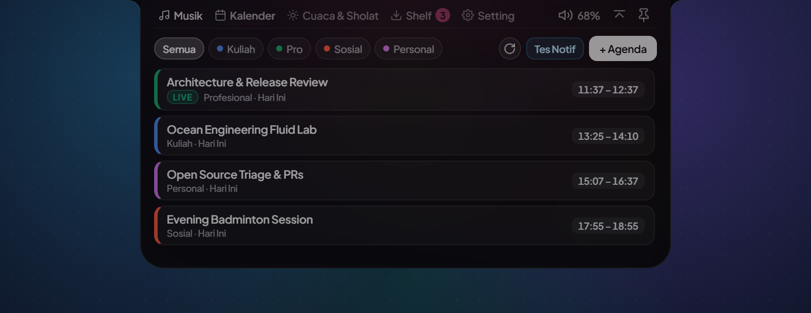
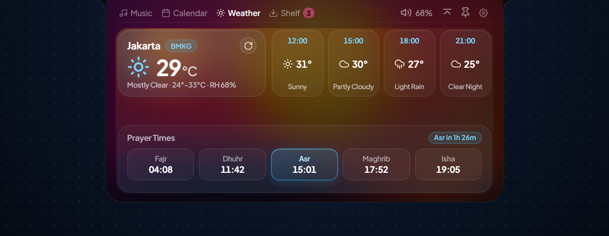
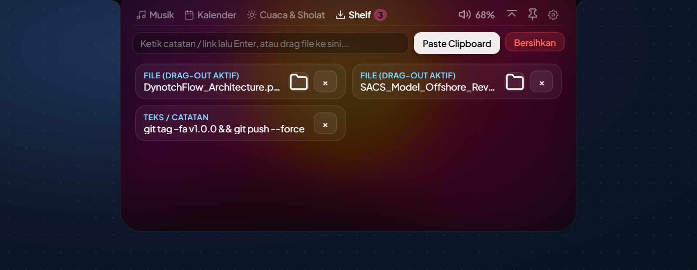
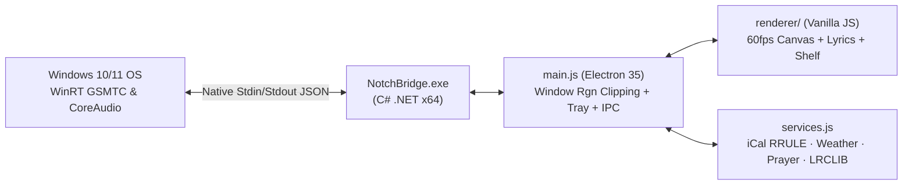

<div align="center">


<br />

# DynotchFlow

**A fast, lightweight Dynamic Island for Windows 10 & 11**  
*Synced music lyrics · Normal Glow & Matte Minimalist themes · Google Calendar (`.ics`) · Weather & prayer alerts · Drag-and-drop file shelf — **under 50 MB RAM**.*

[](https://github.com/Asikraam/DynotchFlow/releases)
[](https://github.com/Asikraam/DynotchFlow/actions)
[](LICENSE)
[](#under-the-hood)

**English** · [Bahasa Indonesia](docs/README_ID.md)

[Download](#-download--install) · [Features](#-whats-inside) · [Gallery](#️-ui-gallery) · [10s Setup](#-10-second-setup) · [Run from Source](#-run-from-source-4-commands)

</div>

---

## ✨ Why DynotchFlow?

- **Featherweight (< 50 MB RAM & 0% CPU Idle):** Sits quietly at the top of your screen (`~11–45 MB` settled memory) alongside a tiny native Windows bridge (`NotchBridge.exe`), so it never slows down games, browsers, or creative tools.
- **Two Clean Themes (`Normal` Glow & `Matte` Minimalist):** Switch between **Normal** (album-reactive glow & subtle weather sky effects) and **Matte Minimalist** (pure `#09090b` / `#121215` obsidian canvas with zero glow). Both themes share the exact same compact geometry (`524×266`) and smooth curved top corners with zero grey titlebar borders.
- **Zero-Effort Synced Lyrics:** Automatically detects what is playing on **Spotify**, **YouTube**, **YouTube Music**, **Chrome**, **Edge**, **Brave**, and **VLC**. Handles R&B/Rap styling (`$` → `s`), VEVO/COLORS/Tiny Desk sessions, acoustic covers, remixes, and *Slowed + Reverb* tracks — centering short lines neatly in the pill, scrolling long ones smoothly, and calming down to `Title · Artist` during intros, instrumental solos, or outros.
- **All-in-One Top Utility Bar:** Glance at **Google Calendar** events, live **Weather & 5 Prayer Times**, adjust Windows volume by scrolling over the pill, and drag files in or out of your **Notch Shelf**.

---

## 📦 Download & Install

Pick the package that fits you from [**GitHub Releases**](https://github.com/Asikraam/DynotchFlow/releases/latest):

| Platform | File | Who It Is For |
| :--- | :--- | :--- |
| **Windows 10 / 11 (x64)** | [`DynotchFlow-Setup-v1.0.0-win-x64.exe`](https://github.com/Asikraam/DynotchFlow/releases/latest) | **Recommended** — 1-click installer (creates Desktop & Start Menu shortcuts) |
| **Windows 10 / 11 (x64)** | [`DynotchFlow-v1.0.0-win-x64-Portable.zip`](https://github.com/Asikraam/DynotchFlow/releases/latest) | **Portable** — Extract anywhere and run `DynotchFlow.exe` with no install |
| **macOS / Linux** | *Source UI only* | Renderer runs from source; Cocoa/MPRIS2 bridges are on the roadmap |

### How to Install (No Coding Required)
1. Download **`DynotchFlow-Setup-v1.0.0-win-x64.exe`** *(or the Portable `.zip`)* from [**Releases**](https://github.com/Asikraam/DynotchFlow/releases/latest).
2. Double-click the `.exe` to install and launch immediately.
3. *(Optional)* Verify the download checksum below.

> **Seeing "Windows protected your PC"?** Open-source indie apps without a paid commercial certificate trigger Windows SmartScreen initially. Click **More info** → **Run anyway**, verify the SHA-256 checksum below, or inspect every build publicly in [**GitHub Actions**](https://github.com/Asikraam/DynotchFlow/actions).

<details>
<summary>SHA-256 Checksums (<code>v1.0.0</code> Windows x64)</summary>

| Artifact | SHA-256 |
| :--- | :--- |
| `DynotchFlow-Setup-v1.0.0-win-x64.exe` | `6A3DA93FE639E3C49E893CDDF7C719F7A0A03B1A08658D346BA80E56531B18B3` |
| `DynotchFlow-v1.0.0-win-x64-Portable.zip` | `548B1ABAE853CD4F44BF226B143E656AC3B38419E14093B24C928683204745B5` |

</details>

---

## 🧩 What's Inside

| Module | What It Does |
| :--- | :--- |
| **Music & Synced Lyrics** | Universal player detection via Windows Media (`GSMTC`) with a **60fps wavy progress scrubber**. Matches lyrics across **LRCLIB**, **iTunes canonical titles**, **Kugou LRC**, and **`lyrics.ovh`**. Click any lyric line to jump straight to that moment, auto-scale tempo on *Slowed / Sped-Up* uploads, and enjoy automatic holds during instrumentals (`[Instrumental]` / `♪` / `>= 10s` breaks) and `> 15 min` full-concert videos. |
| **Normal & Matte Themes** | Pick **Normal** (warm album backdrop & animated weather sky) or **Matte Minimalist** (`#09090b` pure flat dark theme) in **Settings (`⚙`)**. |
| **Multi-Calendar (`.ics`)** | Merge one or multiple Google/Outlook/iCloud iCal (`.ics` / `webcal://`) links plus offline quick events (`+ Event`). **100% private & local on your PC** — `Get Link` opens your own browser's Google Calendar settings. Includes `Study` / `Work` / `Social` / `Personal` filters, auto 5-min sync, `LIVE` & countdown badges, and gentle start alerts. |
| **Weather & Prayer Times** | Auto-detects your Windows timezone city on first run outside Indonesia — using **BMKG & Kemenag RI** across Indonesia and global **Open-Meteo + AlAdhan (MWL)** worldwide — with 5 daily prayers (`Fajr`, `Dhuhr`, `Asr`, `Maghrib`, `Isha`) and H-10m / H-5m / Adzan reminders. |
| **Notch Shelf & Volume** | Drop files, screenshots, or quick notes onto the island and drag files straight back into Explorer, WhatsApp, or browsers. Scroll over the pill volume icon to adjust Windows volume cleanly (`±2`). |
| **Flexible Size & Auto-Hide** | Switch pill height between **`30px` / `34px` / `40px`** (typography scales proportionally), align **Left / Center / Right** or fine-tune horizontally, auto-hide to the top screen edge (`Alt+H`), or hide automatically during fullscreen apps & games. |

---

## 🖼️ UI Gallery

<table>
  <tr>
    <td width="50%" align="center">
      
      <br /><sub><b>Collapsed Pill · Smart Hybrid Lyrics</b><br />Centered short lines (zero side blur fade) · Smooth marquee on overflow</sub>
    </td>
    <td width="50%" align="center">
      
      <br /><sub><b>Matte Minimalist Theme · Music</b><br />Pure <code>#09090b</code> flat canvas · Zero glow · Identical <code>524×266</code> footprint</sub>
    </td>
  </tr>
  <tr>
    <td width="50%" align="center">
      
      <br /><sub><b>Normal Theme · Music &amp; Karaoke</b><br />Album-reactive backdrop · 60fps wavy scrubber · Click-line-to-seek</sub>
    </td>
    <td width="50%" align="center">
      
      <br /><sub><b>Multi-Calendar (<code>.ics</code>)</b><br />Category filters (Study/Work/Social/Personal) · LIVE &amp; countdown chips</sub>
    </td>
  </tr>
  <tr>
    <td width="50%" align="center">
      
      <br /><sub><b>Weather &amp; Prayer Times</b><br />Atmospheric sky glow · BMKG / Open-Meteo forecasts · 5 daily prayers</sub>
    </td>
    <td width="50%" align="center">
      
      <br /><sub><b>Drag-and-Drop Shelf</b><br />Stage files or clipboard notes and drag them back out anytime</sub>
    </td>
  </tr>
  <tr>
    <td width="50%" align="center">
      
      <br /><sub><b>Settings (`⚙`) · Normal Theme</b><br />Size, position, theme switcher, auto-hide &amp; integrations</sub>
    </td>
    <td width="50%" align="center">
      
      <br /><sub><b>Settings (`⚙`) · Matte Minimalist</b><br />Zero-clutter monochrome toggles with collapsible <code>+ JSON API</code> drawer</sub>
    </td>
  </tr>
</table>

---

## ⚡ 10-Second Setup

### 1. Set Your City
On first launch outside Indonesia, DynotchFlow automatically resolves your local city from Windows' system timezone (with zero telemetry). You can also click **`⚙` (Settings)** → enter any city worldwide (e.g., `London`, `Tokyo`, `New York, US`, `Bandung`) → click **Apply** to switch dynamically between **BMKG + Kemenag RI** (Indonesia) and **Open-Meteo + AlAdhan MWL** (global).

### 2. Connect Google Calendar *(Private & Isolated per PC)*
1. Open **Calendar** → click **Connect Google Calendar (.ics)** *(or click **`⚙` → Get Link**)*.
2. Your own default browser opens **your** Google Calendar settings (`calendar.google.com`) — zero shared accounts or preloaded credentials. Scroll down to **Secret address in iCal format** → click **Copy**.
3. DynotchFlow automatically grabs the copied URL and syncs every 5 minutes *(also supports `webcal://` Apple/Outlook feeds, multiple `.ics` URLs separated by commas/spaces, or offline `+ Event` reminders)*.

---

## ⌨️ Shortcuts & Local Push API

| Shortcut / Endpoint | Action |
| :--- | :--- |
| `Alt + H` / `Ctrl + Alt + H` | **Auto-Hide to Top Edge** — tucks the island off-screen; hover the top edge to reveal |
| `Ctrl + Alt + N` | Quickly toggle island visibility on/off |
| `Mouse Scroll` over pill | Step Windows master volume cleanly by `±2` |
| `POST http://127.0.0.1:17420/push` | Push custom JSON toast alerts (`{"title":"Build Done","body":"Passed all checks","accent":"#38bdf8","duration":4500}`) |
| `GET http://127.0.0.1:17420/health` | Local health check (`{"ok":true,"app":"DynotchFlow","version":"1.0.0"}`) |

> All cross-origin browser requests (`Origin`, `OPTIONS`, `Sec-Fetch-Site: cross-site`) are automatically blocked with `HTTP 403` so external websites cannot spoof local notifications.

---

## 🛠️ Run from Source (4 Commands)

Requires **Windows 10/11 (x64)** and **Node.js 18+** (uses Windows' built-in `.NET Framework 4.x csc.exe` — zero Visual Studio install needed):

```powershell
git clone https://github.com/Asikraam/DynotchFlow.git
cd DynotchFlow
npm install
npm start
```

`npm start` automatically runs [scripts/build-bridge.js](scripts/build-bridge.js) to compile `NotchBridge.exe` when missing or modified, then launches Electron immediately.

---

## ⚙️ Under the Hood

<details>
<summary>Architecture, Memory Budget & Credits</summary>



- **Strict `< 50 MB` RAM Engineering:** Caps V8 old-space heap (`--max-old-space-size=48`), runs `--in-process-gpu`, pauses WinRT polling while media is paused, caches DOM lyric nodes, and runs post-boot + idle working-set trimming (`~11–45 MB` settled Private Working Set).
- **Zero-Frame Artifacts:** Pairs native Win32 `MakeFramelessClean` caption stripping with padded `SetWindowRgn` scanline clipping so corners remain crisp on Windows 10 & 11.
- **Credits & License:** Inspired by Apple Dynamic Island, [Alcove](https://tryalcove.com/), and [NotchNook](https://lo.cafe/notchnook). Powered by Electron, Windows Runtime, BMKG Indonesia, Open-Meteo, myQuran (Kemenag RI), LRCLIB, `lyrics.ovh`, and iTunes Search API. Licensed under the [**MIT License**](LICENSE).

</details>
