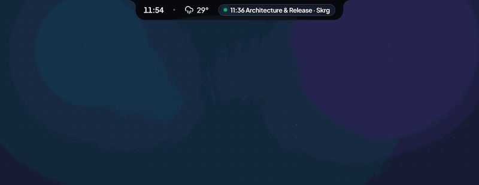
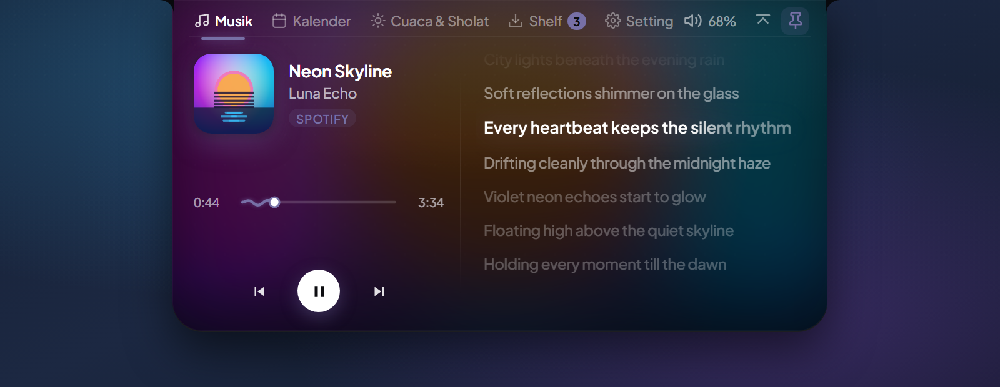
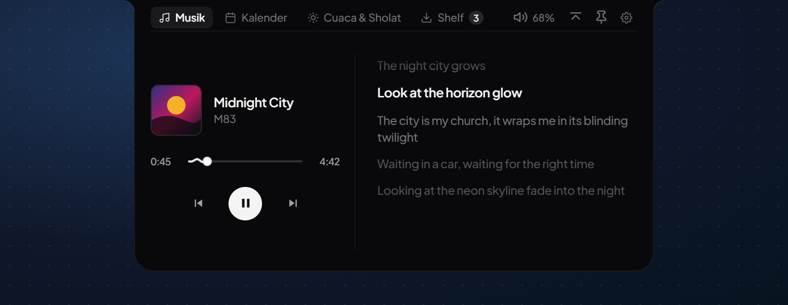
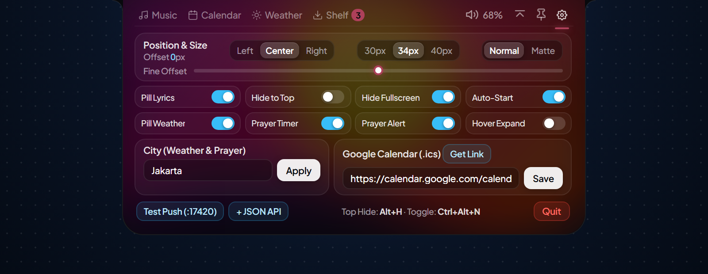
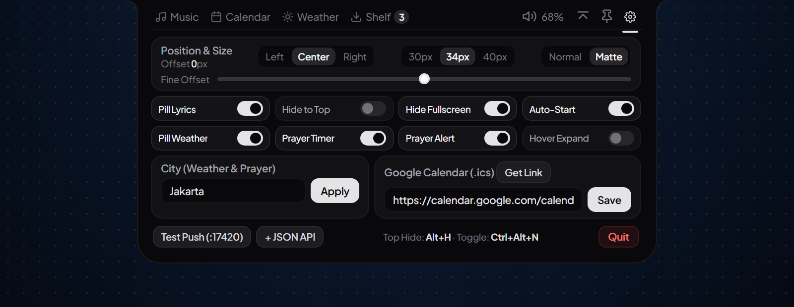

<div align="center">



<br />

# DynotchFlow (`v1.0.1`)

**Dynamic Island super ringan untuk Windows 10 & 11**  
*Lirik lagu sinkron otomatis · Tema Normal Glow & Matte Minimalist · Google Calendar (`.ics`) · Cuaca & Jadwal Sholat · Shelf drag-and-drop — **RAM di bawah 50 MB**.*

[](https://github.com/Asikraam/DynotchFlow/releases)
[](https://github.com/Asikraam/DynotchFlow/releases)

[Back to English README](../README.md) · [Changelog](../CHANGELOG.md) · [Download Rilis](https://github.com/Asikraam/DynotchFlow/releases/latest)

</div>

---

## ✨ Kenapa Pakai DynotchFlow?

- **Sangat Ringan (`< 50 MB` RAM & `0%` CPU saat Idle):** Jalan di atas layar dengan bridge WinRT native super kecil (`NotchBridge.exe`, total RAM settled `~11–45 MB`), aman menemani kerja, browsing multi-tab, maupun main game tanpa bikin berat.
- **2 Tema Rapi (`Normal` Glow & `Matte` Minimalist):** Pilih tema **Normal** (cahaya adaptif sampul album + efek langit cuaca) atau **Matte Minimalist** (permukaan hitam bersih `#09090b` / `#121215` tanpa glow). Ukuran kedua tema **100% identik (`524×266`)** dan sudut lengkung atasnya halus tanpa garis kotak titlebar.
- **Lirik Sinkron Otomatis dari Berbagai Pemutar & Video:** Mendukung **Spotify**, **YouTube**, **YouTube Music**, **Chrome**, **Edge**, **Brave**, hingga **VLC**. Pintar mencocokkan lagu R&B/Rap (`$` → `s`), judul *VEVO / COLORS SHOW / Tiny Desk*, *cover* akustik, maupun *Slowed + Reverb* — baris pendek otomatis rata tengah di pill, baris panjang bergeser halus (*marquee*), dan diam rapi ke `Judul · Artis` saat intro/instrumen/outro tanpa tombol manual yang mengganggu.
- **Semua Kebutuhan Harian di Atas Layar:** Cek jadwal **Google Calendar**, **Cuaca BMKG & 5 Waktu Sholat**, atur volume Windows cukup dengan *scroll* mouse di ikon volume, dan simpan file/catatan sementara di **Notch Shelf**.

---

## 📦 Cara Unduh & Instal (Tanpa Coding)

Pilih file sesuai kebutuhan dari halaman [**GitHub Releases**](https://github.com/Asikraam/DynotchFlow/releases/latest):

| Platform | Paket | Keterangan |
| :--- | :--- | :--- |
| **Windows 10 / 11 (x64)** | `DynotchFlow-Setup-v1.0.1-win-x64.exe` | **Direkomendasikan** — Installer 1-klik ke `%LOCALAPPDATA%\Programs\DynotchFlow` + shortcut |
| **Windows 10 / 11 (x64)** | `DynotchFlow-v1.0.1-win-x64-Portable.zip` | **Portabel** — Ekstrak lalu langsung buka `DynotchFlow.exe` tanpa instalasi |
| **macOS / Linux** | *UI Source* | UI berjalan dari source; dukungan bridge native macOS/Linux menyusul |

### Langkah Instalasi
1. Unduh **`DynotchFlow-Setup-v1.0.1-win-x64.exe`** *(atau file `.zip` portabel)* di [**GitHub Releases**](https://github.com/Asikraam/DynotchFlow/releases/latest).
2. Klik 2x `.exe` untuk memasang dan langsung menjalankan DynotchFlow *(jika update dari `v1.0.0`, langsung timpa tanpa uninstall — setting & kalender aman).*
3. **Jika muncul peringatan Windows Defender SmartScreen (*"Windows protected your PC"*):** Hal ini wajar untuk proyek open-source mandiri tanpa sertifikat berbayar. Cukup klik **More info** → **Run anyway**. Semua kode terbuka dan build binary diverifikasi lewat [**GitHub Actions CI**](https://github.com/Asikraam/DynotchFlow/actions).

---

## 🖼️ Tampilan Fitur & Dual Tema

| Tema Normal (`Music`, `Calendar`, `Weather`, `Shelf`) | Tema Matte Minimalist & Pill Lirik |
| :---: | :---: |
|  |  |
|  |  |

*(Lihat pratinjau lengkap **Collapsed Pill**, **Calendar**, **Weather**, dan **Shelf** di [README Utama](../README.md#️-ui-gallery)).*

---

## ⚡ Pengaturan Kilat (10 Detik)

- **Atur Kota Cuaca & Jadwal Sholat *(Otomatis Deteksi Zona Waktu Global)*:**
  Saat pertama kali dijalankan di luar Indonesia, DynotchFlow otomatis mendeteksi kota dari zona waktu Windows pengguna tanpa pelacakan apa pun — langsung memakai **Open-Meteo + AlAdhan MWL** secara global dan **BMKG + Kemenag RI** di seluruh Indonesia. Kamu juga bisa mengubah kota kapan saja lewat **`⚙` (Settings)** → isi **City (Weather & Prayer)** → **Apply**.
- **Sambungkan Google Calendar *(100% Aman, Terisolasi & Lokal di PC Sendiri)*:**
  1. Buka tab **Calendar** → klik **Connect Google Calendar (.ics)** *(atau **`⚙` → Get Link**)*.
  2. Browser bawaan akan membuka halaman pengaturan Google Calendar milik **akun Google pengguna itu sendiri** *(tanpa akun/kredensial terpasang di repo)*. Pilih kalendermu → gulir ke **Secret address in iCal format** → klik **Copy**.
  3. DynotchFlow langsung mendeteksi link dari clipboard dan sinkron otomatis tiap 5 menit *(mendukung Google `.ics`, `webcal://` Outlook/iCloud, banyak link sekaligus, serta acara offline `+ Event`)*.

---

## ⌨️ Pintasan Keyboard & Tips Cepat

- `Alt + H` / `Ctrl + Alt + H` — Sembunyikan island ke tepi atas layar (*Auto-Hide Top Edge*), sentuh tepi atas layar dengan kursor untuk memunculkannya kembali.
- `Ctrl + Alt + N` — Sembunyikan / tampilkan island secara cepat.
- **Scroll mouse** di ikon volume pada pill — Naik/turunkan volume Windows kelipatan genap (`±2`).
- **Klik baris lirik** saat panel Music terbuka — Langsung lompat ke detik lagu yang diklik *(untuk pemutar yang mendukung seek)*.

---

## 🛠️ Jalankan dari Source Code (Cukup 4 Perintah)

Prasyarat: **Windows 10/11 (64-bit)** dan **Node.js 18+** *(memakai compiler bawaan Windows `.NET Framework 4.x csc.exe`, tidak perlu install Visual Studio)*.

```powershell
git clone https://github.com/Asikraam/DynotchFlow.git
cd DynotchFlow
npm install
npm start
```

`npm start` otomatis memanggil `scripts/build-bridge.js` untuk meng-compile `NotchBridge.exe` jika belum ada atau berubah, lalu langsung menjalankan DynotchFlow.
